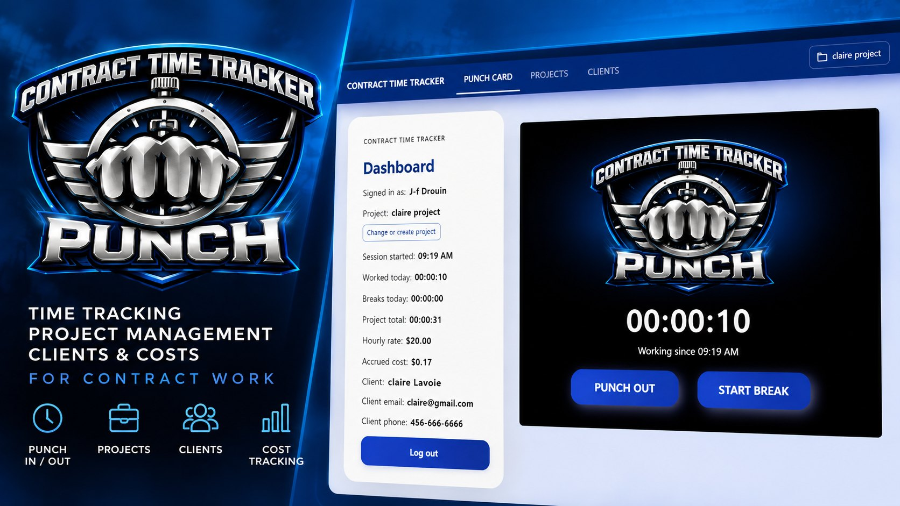
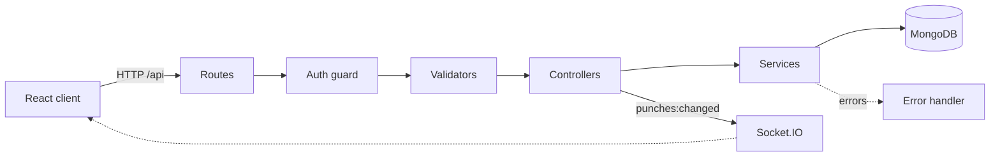
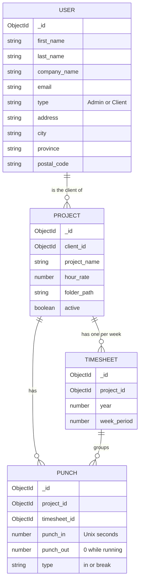

<p align="center">
  
</p>

# Contract Time Tracker

A full-stack web app to track time spent on contract work: punch in and out on a project, take breaks, and see in real time how many hours went into each project and what they're worth at its hourly rate.

I built it for my own freelance work, to replace spreadsheets and guesswork with a punch clock that does the math.

## Features

- **Punch clock:** punch in/out and start/end breaks on a project, with a live timer
- **Dashboard:** time worked and breaks today, project total, accrued cost, and client details
- **Projects:** hours and accrued cost per project, with totals, and a running indicator
- **Clients:** contact details, company name and address
- **Project folders:** save where each project's files live and copy the path in one click
- **Sessions that survive a reload:** secure cookie-based login with Auth.js
- **Live refresh:** punching in one tab updates every other open tab (Socket.IO)
- **Server-side validation** with clear field-level error messages
- **Demo data:** one command fills a separate database with realistic sample data

## Tech stack

| | |
|---|---|
| **Frontend** | React 19, TypeScript, Vite, Material UI, React Router |
| **Backend** | Node.js, Express 5, TypeScript, express-validator |
| **Database** | MongoDB with TypeORM |
| **Auth** | Auth.js (credentials, JWT session cookie), bcrypt |
| **Real time** | Socket.IO |

## Architecture

The repository holds two apps: the React client and the REST API.

```
website/
├── client/   React + Vite front end      (http://localhost:3000)
└── server/   Express REST API + Auth.js  (http://localhost:5000)
```

In development, Vite proxies `/api` and `/socket.io` to the API, so the browser only talks to one origin and the session cookie just works.

The API follows a layered structure where each layer has one job:



- **Routes:** map URLs to controllers. Every route except `/api/auth/*` requires a session.
- **Validators:** check and clean the input (express-validator). Invalid requests stop here with a 422.
- **Controllers:** handle HTTP only: read the request, call a service, send the response.
- **Services:** business logic and database access. They throw `HttpError`s that a single error handler turns into responses.

### Data model



## Getting started

**Requirements:** Node.js 20+ and a local MongoDB server.

```bash
git clone https://github.com/j-fdev/contract-time-tracker.git
cd contract-time-tracker
```

**1. API**

```bash
cd server
npm install
cp .env.example .env      # Windows: copy .env.example .env
```

In `.env`, set `AUTH_SECRET` (the file explains how to generate one) and set `DB_NAME=contract_time_tracker_demo`. Then fill the demo database and start the API:

```bash
npm run seed:demo
npm run dev
```

**2. Client** (in a second terminal)

```bash
cd client
npm install
npm run dev
```

Open http://localhost:3000 and log in with the demo account:

> **Email:** `demo@contracttimetracker.dev`
> **Password:** `Demo-Tracker-2026!`

The demo account only exists in the local demo database created by the seed script. More details about the API and its endpoints are in [`server/README.md`](server/README.md).

## Roadmap

- [ ] Invoices and PDF reports per project and per period
- [ ] Edit and archive projects and clients from the UI
- [ ] Only one running punch at a time across projects
- [ ] Per-user data, so several freelancers can use the same instance
- [ ] Automated tests (Jest)
- [ ] Mobile app

## Author

**Jean-François Drouin**: [github.com/j-fdev](https://github.com/j-fdev)

© 2026 Jean-François Drouin. All rights reserved. This code is shared for portfolio purposes.
